# Photo to Relief Magnet

[中文说明](README.zh-CN.md)

An open Codex skill for turning reference photos into polished, generation-ready concepts and prompts for painted bas-relief fridge magnets.

It helps an agent decide between die-cut and framed structures, preserve the right identity cues, simplify clutter, keep a product series consistent, write complete image-generation prompts, and verify whether a PNG contains real transparency.

## Before and After Examples

The source photos below are shown beside their generated painted bas-relief concepts. These are opaque presentation renders, not transparent assets, manufactured samples, or claims of production readiness.

| Source photo | Generated relief concept |
| --- | --- |
| 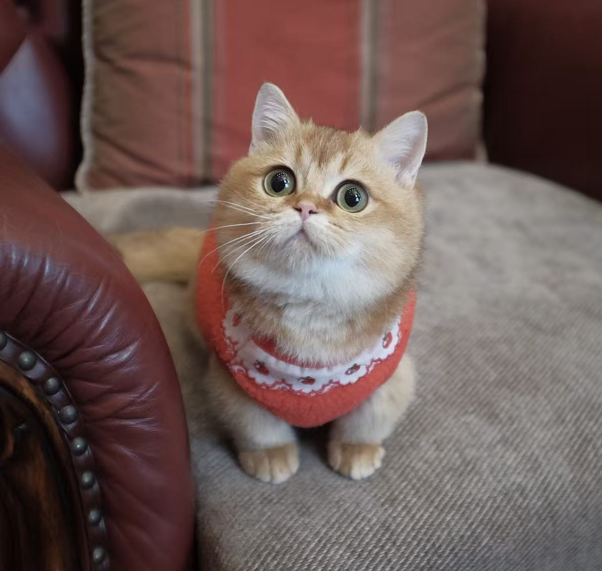 | 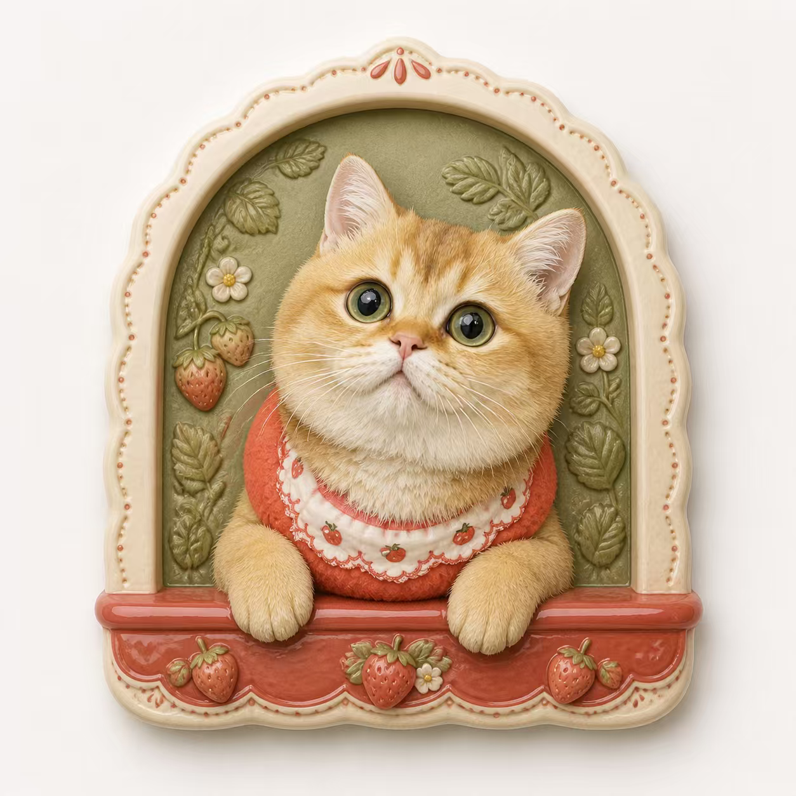 |
| 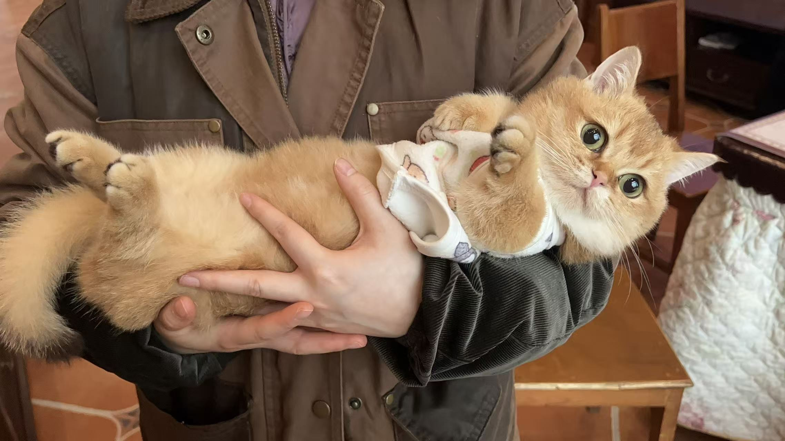 | 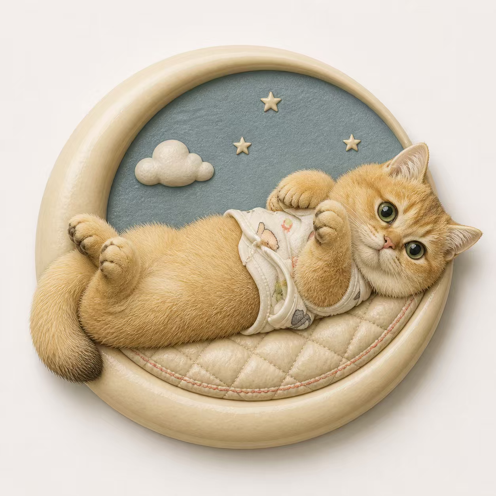 |
| 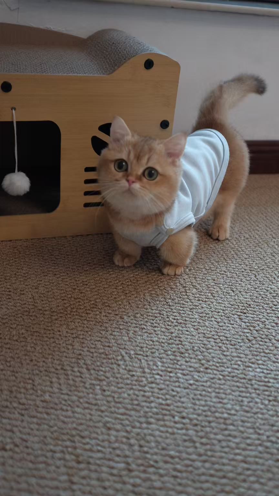 | 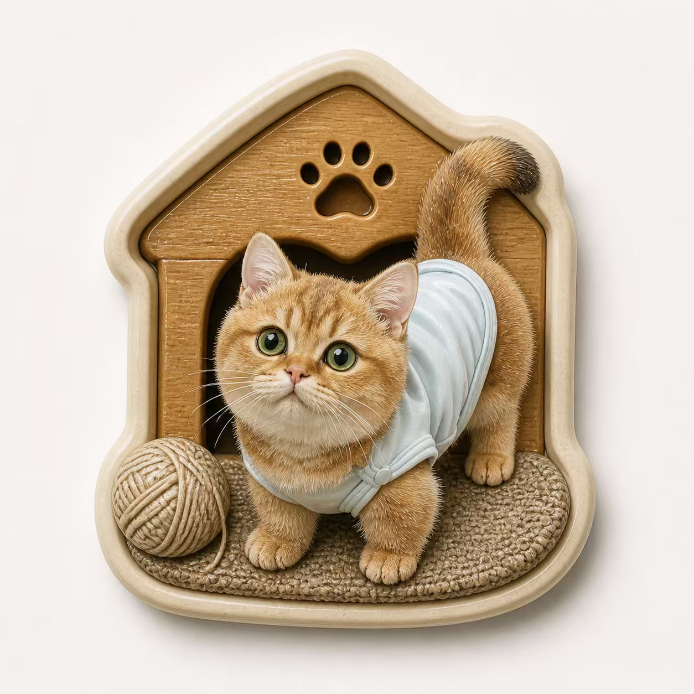 |
| 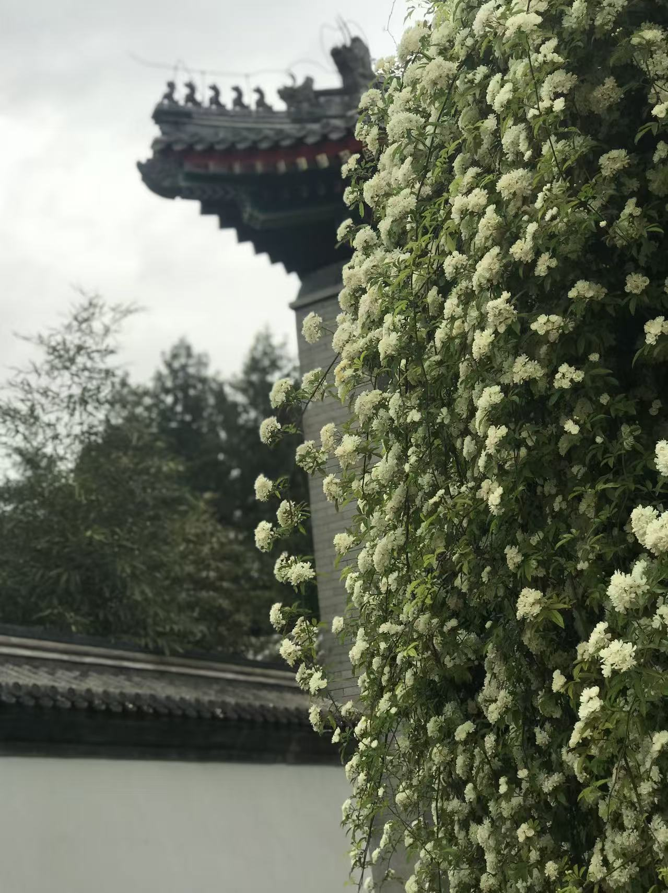 | 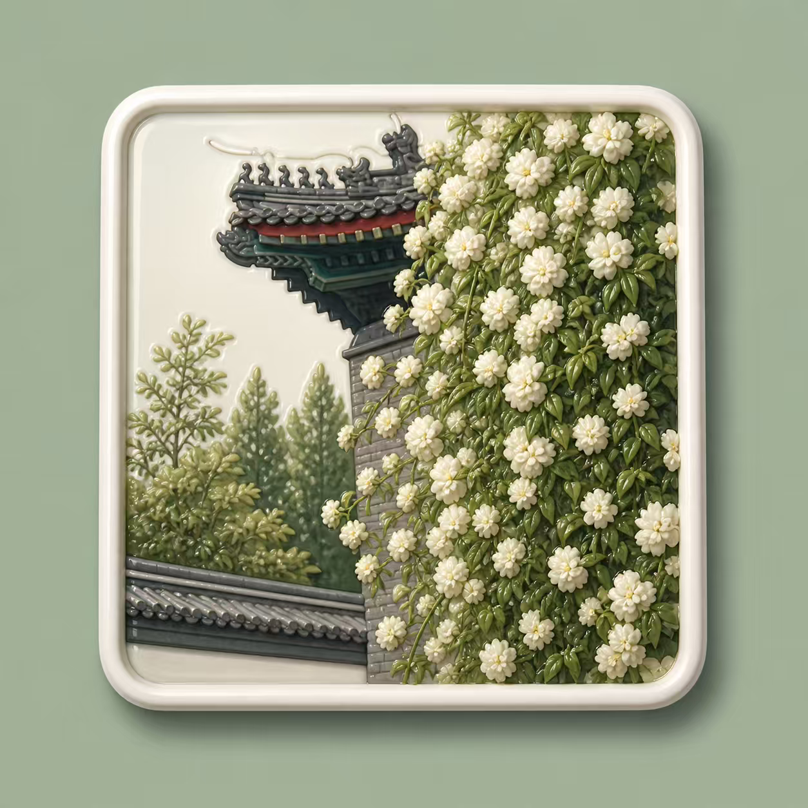 |
| 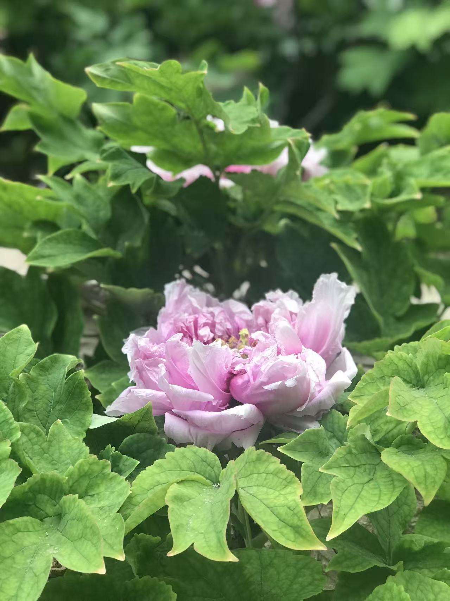 | 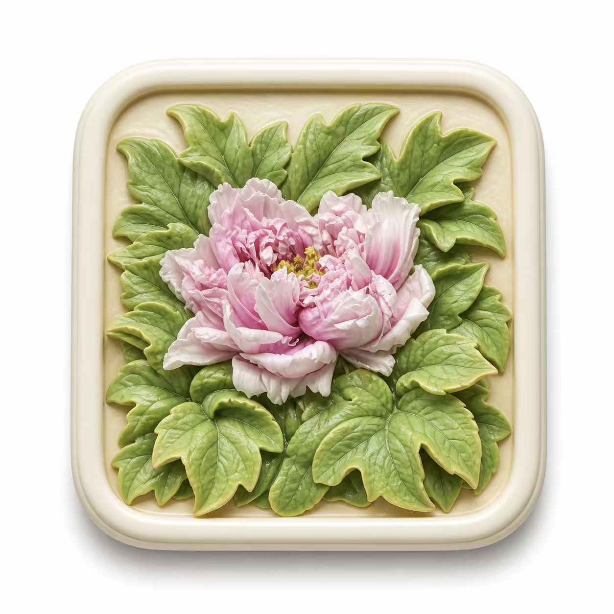 |
| 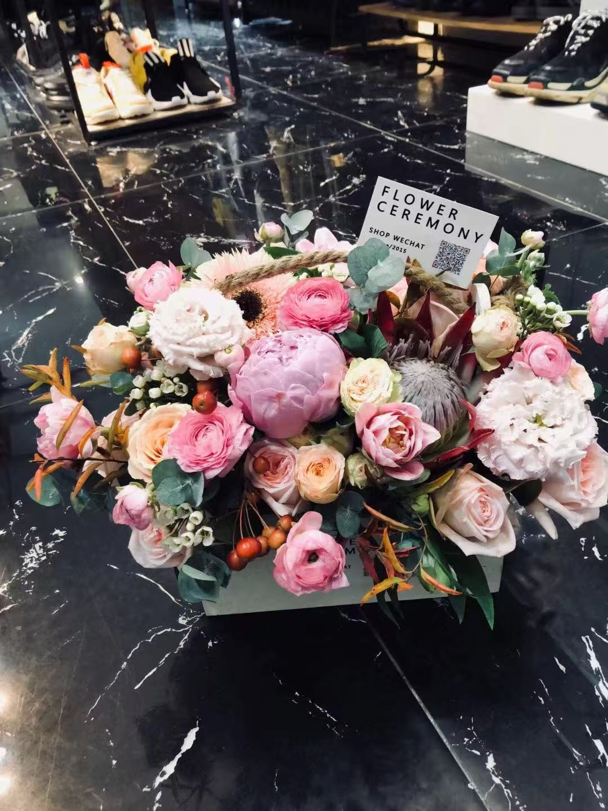 | 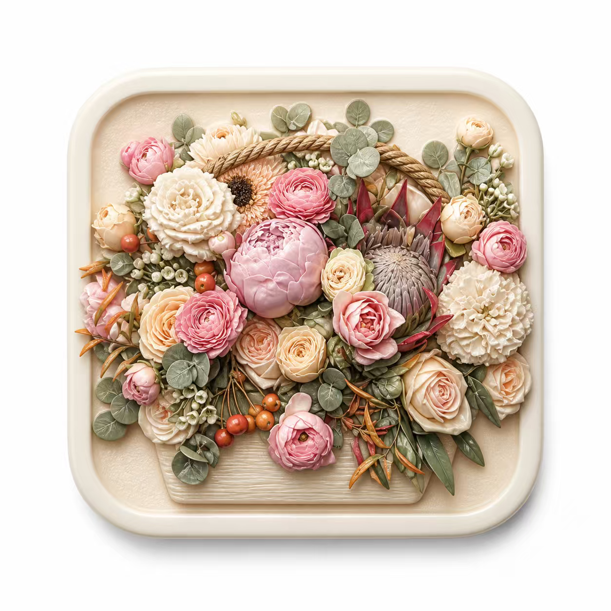 |

## What It Does

- Handles pets, bouquets, flowers, landscapes, architecture, landmarks, and keepsake photos.
- Defaults to one independent magnet per photo; it combines references only when explicitly requested.
- Separates the physical magnet body from the presentation canvas and shadow.
- Regenerates from a complete revised prompt while preserving previously accepted design choices.
- Includes a dependency-free PNG alpha checker.
- Clearly labels outputs as concept renders rather than manufactured samples or production-ready 3D files.

This skill does **not** create CAD, STL, depth maps, tooling plans, or validated manufacturing files.

## Install

Download or clone this repository into your Codex skills directory:

```bash
git clone https://github.com/pyj1993q-tech/photo-to-relief-magnet.git ~/.codex/skills/photo-to-relief-magnet
```

On Windows PowerShell, the equivalent default location is:

```powershell
git clone https://github.com/pyj1993q-tech/photo-to-relief-magnet.git "$env:USERPROFILE\.codex\skills\photo-to-relief-magnet"
```

Restart Codex or open a new task after installation.

## Use

Upload one or more photos and invoke the skill:

```text
Use $photo-to-relief-magnet to turn this photo into a premium painted-resin
bas-relief fridge-magnet concept. Keep the dog's expression and plaid collar,
remove the shop background, and show it on a white presentation canvas.
```

Useful details to provide:

- what must remain recognizable;
- what may be deleted or simplified;
- whether multiple images should stay separate or be combined;
- whether exact text must be retained;
- whether you need a display render or a genuinely transparent PNG.

## Check PNG Transparency

The checker uses only the Python standard library. Inspect one or more PNG files:

```bash
python scripts/check_png_alpha.py output.png
python scripts/check_png_alpha --json output-a.png output-b.png
```

The checker distinguishes real non-opaque pixels from a missing alpha channel or an alpha channel whose pixels are all fully opaque. It does not validate print cut paths or manufacturing readiness.

## Repository Layout

```text
photo-to-relief-magnet/
|-- SKILL.md
|-- agents/openai.yaml
|-- assets/
|   |-- icon-400.png
|   `-- icon-1024.png
|-- examples/
|   `-- six source-and-result pairs
|-- references/
|   |-- design-guide.md
|   |-- prompt-blueprint.md
|   `-- qc-checklist.md
|-- scripts/check_png_alpha.py
`-- README.md
```

## Privacy and Rights

Only upload photos you are allowed to use. Review generated results before sharing them, especially when they contain people, private locations, brands, protected characters, QR codes, or exact memorial text. The example photos in this repository are included with explicit permission from their owner.

## License

[MIT](LICENSE)
